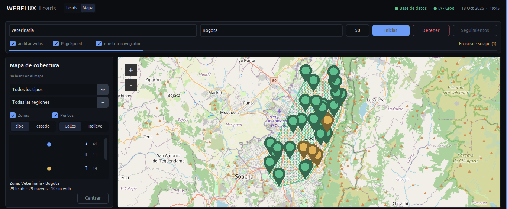

# Webflux · Leads

Herramienta de escritorio para **conseguir y trabajar clientes potenciales** (prospectos) de negocios locales: busca negocios en Google Maps, revisa sus páginas web, redacta un primer mensaje de WhatsApp personalizado con IA y lleva el seguimiento de cada uno, todo en una sola ventana en modo oscuro.

Pensada para quien ofrece servicios de desarrollo web y automatización a negocios de su zona.


---

## Qué hace

```
Google Maps ──► Postgres ──► Auditoría web ──► Mensajes con IA ──► WhatsApp (manual) ──► Seguimiento
 (Playwright)    (leads)     (httpx/PageSpeed)     (Groq A/B)          (wa.me)             (CRM + mapa)
```

1. **Scraping de Google Maps**: escribes tipo de negocio y ciudad (por ejemplo `restaurantes` en `Aguachica`) y el programa recorre los resultados. Guarda nombre, teléfono, web o red social y enlace de Maps.
2. **Filtro de contactos**: solo se guardan **celulares colombianos** (empiezan por `3`), que son los que sirven para WhatsApp. Los fijos se descartan y no se repiten leads ya guardados.
3. **Auditoría de webs** (opcional): revisa la página de cada negocio y detecta problemas reales que sirven de gancho (ver más abajo).
4. **Mensaje personalizado**: la IA (Groq) escribe un primer mensaje corto usando esos hallazgos, en dos variantes (A/B) para comparar cuál responde mejor.
5. **Envío manual**: el botón *WhatsApp* abre `wa.me` con el mensaje ya escrito. **El programa nunca envía mensajes solo**; tú lo revisas y lo mandas.
6. **CRM**: cada lead tiene un estado (nuevo, contactado, respondió…), notas y un mensaje de seguimiento que se genera cuando pasan 3 días sin respuesta.
7. **Mapa**: muestra dónde has hecho scraping y qué tipos de negocio hay en cada zona.

---

## Requisitos

| Qué | Para qué |
|---|---|
| **Python 3.10 o superior** (probado con 3.12) | ejecutar el programa |
| **Tkinter** | la ventana. Viene con Python en Windows y macOS; en Linux: `sudo apt install python3-tk` |
| **PostgreSQL** (local o en Docker) | guardar los leads |
| **Cuenta de Groq** (gratis) | generar los mensajes → <https://console.groq.com> |
| **Conexión a internet** | Google Maps, auditorías y mosaicos del mapa |
| Chromium de Playwright | lo instala el paso 3 de la instalación |
| *(opcional)* clave de PageSpeed | subir la cuota de las pruebas de velocidad |

Paquetes de Python (están en `requirements.txt`):

`playwright` · `groq` · `httpx` · `psycopg2-binary` · `python-dotenv` · `customtkinter` · `tkintermapview`

---

## Instalación

**1. Entorno e instalación de paquetes**

```bash
python -m venv .venv
source .venv/bin/activate          # Windows: .venv\Scripts\activate
pip install -r requirements.txt
```

**2. Navegador para el scraper**

```bash
playwright install chromium
```

**3. Base de datos.** Si no tienes Postgres, con Docker es una línea:

```bash
docker run -d --name pg-leads -p 5432:5432 -e POSTGRES_PASSWORD=1234 postgres
```

Las tablas se crean solas la primera vez que abres el programa.

**4. Configuración.** Copia `env.example` como **`.env`** (con el punto, sin la extensión `.example`) y rellénalo:

| Variable | Qué es | Por defecto |
|---|---|---|
| `DB_HOST` | servidor de Postgres | `localhost` |
| `DB_PORT` | puerto | `5432` |
| `DB_NAME` | base de datos | `postgres` |
| `DB_USER` | usuario | `postgres` |
| `DB_PASS` | contraseña | *(vacía: debes ponerla)* |
| `GROQ_API_KEY` | clave de Groq, sin comillas ni espacios | — |
| `GROQ_MODEL` | modelo de IA | `openai/gpt-oss-20b` |
| `PAGESPEED_API_KEY` | clave de Google PageSpeed (opcional, gratis) | — |

> El `.env` tiene claves personales: **no lo subas a GitHub**. Si versionas el proyecto, añade `.env` a `.gitignore`.

**5. Abrir el panel**

```bash
python panel.py
```

En la cabecera verás `● Base de datos` y `● IA · Groq` en verde si todo quedó bien.

---

## Cómo se usa el panel

### 1. Buscar negocios


Arriba están los campos de búsqueda:

- **Negocio(s)** y **ciudad(es)**: puedes poner varios separados por coma (`restaurantes, odontólogos` × `Aguachica, Ocaña`) y se hacen todas las combinaciones.
- **Máx**: tope de negocios por búsqueda.
- **Auditar webs** y **PageSpeed**: ver la sección siguiente.
- **Mostrar navegador**: abre Chrome visible para ver qué hace el scraper (útil si algo falla).
- **Iniciar / Detener**: lanza o cancela el proceso. Corre en segundo plano; el registro de abajo muestra el avance.
- **Seguimientos**: genera el mensaje de seguimiento para quienes llevan 3 días o más contactados sin responder.

### 2. Secciones

Cada búsqueda crea una **sección** en la columna izquierda, con su cantidad de leads y cuántos son nuevos. Al elegirla, la lista muestra solo los leads de esa búsqueda. *Todos los leads* los junta. Se puede **eliminar una sección** (borra también sus leads) o **eliminar un lead** suelto; siempre pide confirmación.

### 3. Trabajar un lead

Al seleccionar un lead a la derecha ves su teléfono, web, red social, correo, enlace de Maps y los **hallazgos** de la auditoría.

- **WhatsApp**: abre el chat con el mensaje listo. Si está marcada la casilla, el lead pasa solo a *contactado*.
- **Copiar / Guardar**: copia el texto, o guarda tus ediciones y la nota.
- **Regenerar**: pide a la IA otro mensaje.
- **Mensaje / Seguimiento**: dos pestañas editables.
- **Botones de estado**: *Contactado, Respondió, Cotizado, Cerrado, Descartar*.

| Estado | Significado |
|---|---|
| nuevo | recién encontrado, sin contactar |
| contactado | ya le escribiste |
| respondió | contestó |
| cotizado | le enviaste una propuesta |
| cerrado | venta lograda |
| descartado | no volver a contactar (no reaparece si repites la búsqueda) |

Atajos: `Enter` en los campos de búsqueda inicia el scraping, `Supr` elimina el lead seleccionado y `Esc` salta la pantalla de arranque.

### 4. Mapa



La pestaña **Mapa** (arriba, junto al logo) muestra la cobertura de tus búsquedas: la zona que cubre cada scraping y un punto por lead. Puedes filtrar por tipo de negocio y por región, activar o quitar las capas *Zonas* y *Puntos*, colorear por tipo o por estado, cambiar entre *Calles* y *Relieve* y centrar la vista. Sirve para ver de un vistazo en qué zonas ya trabajaste y no repetir búsquedas. Necesita internet para cargar el mapa.

---

## Qué revisa la auditoría de webs

Para cada negocio con página web, el programa la descarga y busca cosas que puedes usar como argumento de venta:

- Si carga o da error, si tiene **HTTPS** y si el certificado está vencido o es inválido.
- Si se **adapta al celular** (responsive).
- Si tiene **botón de WhatsApp**.
- El año del **copyright** del pie de página (por ejemplo, «2019» sugiere abandono).
- Con qué está hecha (WordPress, Wix, Squarespace, Shopify, Webflow, Blogger, Joomla), correos visibles y redes sociales.

**PageSpeed** añade un puntaje de velocidad en celular (0 a 100) usando la API gratuita de Google; por debajo de 50 se considera lento. Es la parte más lenta del proceso. Con `PAGESPEED_API_KEY` en el `.env` la cuota es mayor.

Los negocios **sin web** se marcan como oportunidad directa: «lead ideal para ofrecerle una».

Si quieres rapidez: deja *auditar webs* activo y desmarca *PageSpeed*. Si desmarcas ambos, solo se traen los datos de Maps.

---

## Los mensajes (A/B)

Cada lead recibe una de dos variantes al azar. Ambas son un mensaje corto y natural que menciona un hallazgo real del negocio; solo cambia la pregunta final:

- **A**: pregunta si les interesaría saber cómo podrías ayudarles.
- **B**: pregunta cuál es la tarea repetitiva que más tiempo les quita al día.

Con el tiempo puedes ver qué variante obtiene más respuestas con `python scraping.py --stats`. Si no hay clave de Groq o la IA falla, se usa un mensaje de respaldo genérico y el registro lo avisa.

---

## Uso desde la terminal

El scraper también funciona sin ventana:

```bash
python scraping.py "restaurantes" "Aguachica" --max 30      # una búsqueda
python scraping.py --lote lote.json                         # varias a la vez
python scraping.py --listar nuevo                           # listar leads por estado
python scraping.py --estado 12 contactado                   # cambiar el estado de un lead
python scraping.py --seguimientos                           # generar seguimientos
python scraping.py --stats                                  # embudo y resultados A/B
```

Opciones útiles: `--debug` (muestra el navegador), `--sin-auditoria`, `--sin-pagespeed`.
Formato de `lote.json`: `{"negocios": ["restaurantes"], "lugares": ["Aguachica", "Ocaña"]}`

---

## Estructura del proyecto

```
panel.py          ventana principal (interfaz, secciones, detalle, mapa)
scraping.py       scraper de Google Maps, generación de mensajes y línea de comandos
auditoria.py      revisión de páginas web y PageSpeed
db.py             base de datos (PostgreSQL): leads, secciones, estados, estadísticas
requirements.txt  paquetes de Python
env.example       plantilla de configuración (cópiala como .env)
docs/             capturas del README
```

Cualquier módulo auxiliar (por ejemplo, del mapa) debe estar en la misma carpeta que `panel.py`. El programa crea además `.panel_estado.json`, donde recuerda tu última búsqueda y la sección abierta.

**Base de datos.** Dos tablas principales: `scrapes` (una fila por búsqueda = una sección) y `prospectos` (los leads, ligados a su sección). Al borrar una sección se borran sus leads. Un lead no se guarda dos veces: se compara por el identificador de Maps y por el teléfono.

---

## Personalización

Arriba de `panel.py` hay opciones que puedes cambiar a mano:

- `SPLASH = False` quita la pantalla de arranque.
- La **paleta de colores** (`BG`, `PANEL`, `ACENTO`…) y `RADIO` (esquinas redondeadas) están juntas en un solo bloque.
- Las instrucciones de la IA y los tipos de mensaje A/B están en `scraping.py`.

---

## Problemas comunes

| Síntoma | Causa y solución |
|---|---|
| `fe_sendauth: no password supplied` | No encuentra el `.env` o falta `DB_PASS`. Debe llamarse exactamente `.env` y estar junto a `panel.py`. |
| `● Sin base de datos` / no conecta | Postgres no está levantado (`docker ps`) o los datos del `.env` no coinciden. |
| `● IA desactivada` | Falta `GROQ_API_KEY` en el `.env`. Reinicia el panel después de editarlo. |
| La búsqueda termina con «Sin contactos nuevos» | Maps no mostró teléfono (el scraper abre la ficha de cada negocio para buscarlo) o los números eran fijos. El registro indica cuántos hubo de cada tipo. Prueba con *Mostrar navegador*. |
| Error al abrir el navegador del scraper | Falta `playwright install chromium`. |
| `No module named 'tkinter'` (Linux) | `sudo apt install python3-tk`. |
| El mapa sale gris o vacío | Sin internet, o falta `pip install tkintermapview`. |
| PageSpeed tarda mucho o falla | Es lento por naturaleza y tiene cuota limitada. Pon `PAGESPEED_API_KEY` o desmárcalo. |

---

## Uso responsable

- Los datos salen de fichas públicas de Google Maps, pero **automatizar Google Maps puede ir contra sus términos de uso**. Úsalo con moderación y a pequeña escala.
- Los números de teléfono son datos personales: en Colombia aplica la **Ley 1581 de 2012** (protección de datos personales). Escribe solo a negocios, con un mensaje claro, ofrece dejar de contactarlos si lo piden y no compartas la base de datos.
- Por eso el envío es **siempre manual**: tú decides a quién escribir y qué decir.
- Las capturas de este README muestran datos de negocios reales; cámbialas si vas a publicar el proyecto.
